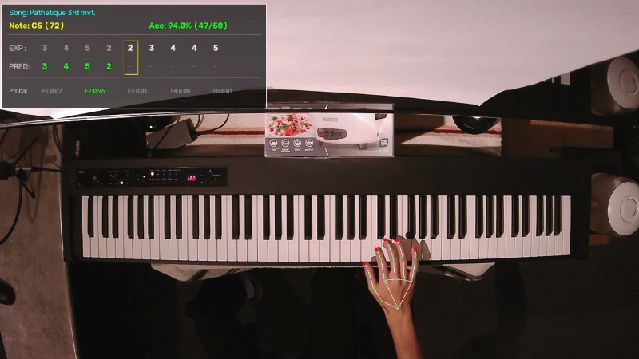

# Real-Time ML Piano Fingering Prediction & Evaluation Pipeline



A computer vision and machine learning pipeline that predicts piano fingerings in real time. The system fuses MediaPipe 2D hand landmark tracking with live digital piano MIDI inputs and evaluates model performance using an OpenCV evaluation display.

## Key Metrics & Pipeline Architecture

- **Out-of-Fold CV Accuracy:** 98% cross-validation score across multi-octave scale and arpeggio exercise patterns.
- **Live Performance Benchmark:** 92% live accuracy (80/87 sequence matches) tested on the beginning of Beethoven's *Pathétique Sonata* (3rd Movement).
- **Pitch-Invariance:** Uses a 43-dimensional spatial feature vector excluding absolute target note pitch to prevent memorization bias and generalize across key transpositions.

### Feature Extraction (43 Dimensions)

For every MIDI `note_on` event, the system builds a feature vector comprising:

1. **Normalized Hand Geometry (40D):** Relative $(dx, dy)$ coordinates for 20 non-wrist MediaPipe hand landmarks, normalized by wrist position and scaled by hand size.
2. **Fingertip Distances (5D):** Euclidean distance from the wrist to all 5 fingertips.
3. **Camera Key Proximities (10D):** Signed ($\Delta x$) and absolute ($|\Delta x|$) horizontal distances from fingertips to key centers calibrated via 3-point OpenCV linear projection.
4. **Relative Movement (2D):** Pitch delta ($\text{Pitch}_{\text{curr}} - \text{Pitch}_{\text{prev}}$) and scaled octave anchor.

## Quickstart

### Prerequisites

- Python 3.10+
- Digital Piano / MIDI Keyboard connected via USB
- Webcam (1280x720 recommended)

### 1. Environment Setup

Create and activate a virtual environment based on your operating system:

```bash
# Create virtual environment
python -m venv .venv

# Activate environment
source .venv/bin/activate # macOS / Linux
.venv\Scripts\activate.bat # Windows Command Prompt
.venv\Scripts\Activate.ps1 # Windows PowerShell

# Install dependencies
pip install -r requirements.txt
```

### 2. Camera & Keyboard Calibration

Run the calibration script to align camera landmark space with physical piano key positions:

```bash
python 0_calibrate.py
```

### 3. Live Evaluation Pipeline

Run the real-time inference loop and visual display:

```bash
python 4_test_accuracy.py
```

## Custom Training Data

To record new sessions, process raw takes, and retrain the model on custom key patterns or hand shapes, refer to training_instructions.md.

## System Limitations & Dataset Scope

- **Single-Subject Bias:** Model weights are trained on single-subject hand geometry and posture, which may lower prediction accuracy on unseen hand sizes or technique variants.
- **Hardware Dependencies:** Key proximity calculations assume standard keybed dimensions and depend on fixed overhead camera positions.
- **Occlusion During Crossovers:** Fast thumb-under or finger-over transitions introduce temporary landmark occlusions.
- **Single-Hand Scope:** Feature extraction currently processes a single active hand without two-hand multi-touch tracking.

## Future Directions

- Replace point-in-time Random Forest predictions with LSTM or Transformer models to leverage sequence context.

- Expand landmark extraction to process both hands simultaneously across all keys.

- Integrate LiDAR / depth-sensing or multi-camera setups to resolve joint occlusions during complex crossovers.

- Extend data collection and spatial classification pipelines to handle simultaneous multi-note triggers and chord voicing.

- Collect benchmark data across diverse hand anatomies, keybed dimensions, and lighting conditions.

- Build automated data collection interfaces and CLI utilities to make recording and retraining accessible for new users.